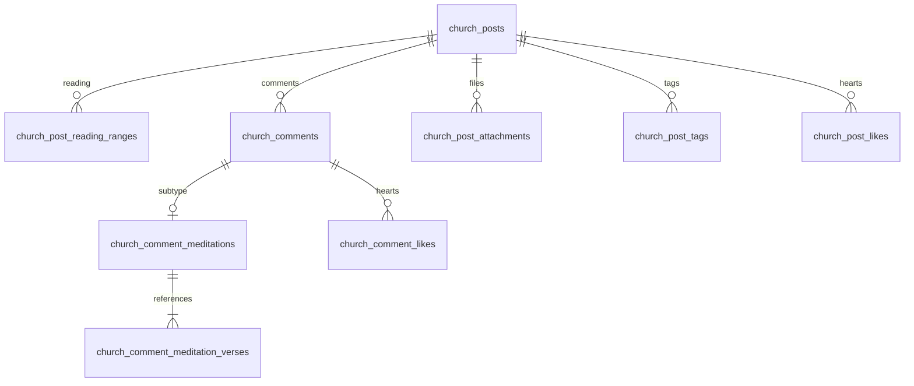

# 공동체 커뮤니티 구현·배포 안내

## 구현 범위

- 공동체 상세의 **공동체 이야기**에서 글 목록·작성·상세·수정으로 이동합니다.
- 현재 승인된 공동체 회원만 조회·작성할 수 있습니다. 작성자는 수정·삭제, 대표/부관리자는 다른 회원의 글·댓글 삭제가 가능합니다.
- 글·댓글에 하트를 누르거나 취소할 수 있습니다. `(대상, 회원)` 유일 키와 원하는 상태를 전달하는 API로 중복 하트를 방지합니다.
- Tiptap 3.32.0 오픈소스 에디터 + Expo DOM을 사용합니다. 굵게·기울임·밑줄·취소선·제목·목록·인용·링크, 본문 중간 이미지 삽입·이동·삭제·되돌리기를 지원합니다.
- 본문은 JSON으로 저장하며 이미지는 `attachmentId`만 포함합니다. 임시 다운로드 URL은 별도로 관리하므로 URL 갱신이 글 수정 기록이나 커서 위치를 바꾸지 않습니다.
- 일반 파일 첨부, 태그 정규화·자동 제안·태그별 글 목록을 지원합니다.
- 글 유형은 일반 글 / 함께 성경읽기이며 게시 후 유형 변경은 제한합니다.
- 함께 성경읽기는 성경별 단일 장·연속 구간·여러 구간을 설정합니다. 겹치거나 이어진 구간은 합칩니다.
- 해당 글에는 일반 댓글과 **구절 + 묵상 댓글**을 모두 작성할 수 있습니다. 새 묵상은 **개역한글판** 본문을 기준으로 여러 장에서 최대 50절을 선택합니다.
- 첫 묵상 등록 시 읽을 범위를 영구 잠급니다. 묵상을 모두 삭제해도 잠금이 풀리지 않습니다. 제목·본문·태그는 계속 수정할 수 있습니다.

## 데이터와 권한



댓글 공통 테이블은 작성자·권한·수정 버전·하트를 담당하고, 묵상 내용/번역본 및 성경·장·절은 하위 테이블에 저장합니다. 일반 댓글에는 묵상 하위 행이 없어야 하며, 묵상 댓글에는 묵상 1개와 구절 1~50개가 있어야 합니다. 복합 외래 키와 지연 제약 트리거로 공동체·글·댓글·번역본의 불일치를 차단합니다.

공개 테이블에 RLS를 켜고 `anon`/`authenticated`의 직접 테이블 접근은 차단했습니다. `public.church_community`는 invoker wrapper이며 `church_community_private.api`에서 매 요청 현재 회원 자격과 작성자/관리자 권한을 검사합니다. 내부 helper 실행 권한도 차단합니다. 모든 bigint 식별자는 클라이언트에 문자열로 반환합니다.

RPC action은 `list_posts`, `get_post`, `save_post`, `delete_post`, `like_post`, `list_comments`, `save_comment`, `delete_comment`, `like_comment`, `suggest_tags`입니다. 이전 앱 호환용 `verse_ids`도 유지하지만 현재 앱은 정적 JSON에서 절 번호를 읽습니다. 개별 public 함수 대신 한 진입점에서 동일한 인증·멱등성·오류 정책을 적용합니다. 글·댓글 저장은 트랜잭션이고, 수정 시 `expected_version`, 묵상 저장 시 `expected_reading_version`을 검사합니다. 저장 요청 ID와 payload SHA-256을 보관하며 삭제된 글의 내용은 멱등성 저장소에 복제하지 않습니다.

목록은 `(created_at,id)` cursor를 사용합니다. 캐시 키에 공동체와 현재 사용자를 포함하고, 로그아웃·사용자 변경·회원 탈퇴 시 취소/초기화합니다. 접근 오류 시 이전 캐시 내용을 숨깁니다.

## 성경 구절 목록

새 묵상 댓글은 개역한글판(`ko-krv`)으로 작성하며, 구절 선택 화면과 저장된 묵상에 번역본을 표시합니다. 본문은 기존 앱의 개역한글판 데이터 경로를 재사용하고, 구절 번호 검증도 같은 번역본의 목록을 사용합니다.

기존에 다른 번역본으로 저장한 묵상은 조회·수정할 때 원래 번역본을 유지합니다. 이를 위해 DB/API와 구절 목록에는 기존 앱의 개역한글판, KJV(`en-kjv`), Luther 1912(`de-luther1912`)를 계속 지원합니다. 각 번역본의 66권·1,189장, 전체 3,567장에서 실제 구절 ID를 확인했습니다.

- `domain/community/books.json`: 66권의 이름·순서·최대 장 수
- `domain/community/bible-catalog.json`: 번역본·성경·장별 유효한 절 목록 및 원문 SHA-256
- `domain/community/bible-reference.ts`: 앱의 정적 장·절 조회. 구절 선택 시 Supabase 요청이 필요하지 않습니다.
- `scripts/build-community-bible-catalog.mjs`: 원본 재검증 및 정적 JSON 생성. 임시 폴더 캐시로 중단 후 재개 가능하며 SQL이나 시드를 변경하지 않습니다.
- `scripts/generate-community-bible-sql.mjs`: 위 JSON에서 서버용 불변 검증 함수를 생성합니다. `--check` 옵션은 파일을 수정하지 않고 생성 결과의 일치를 검사합니다.

성경 기준 테이블과 시드는 사용하지 않습니다. DB에는 사용자가 작성한 글·묵상·선택한 구절 참조를 저장합니다. 서버에서는 앱을 거치지 않은 잘못된 입력도 차단해야 하므로, 같은 정적 JSON에서 만든 작은 함수 상수를 사용합니다. 연속된 절은 장별 절 수로 압축하고, 누락된 번호가 있는 장은 실제 번호를 그대로 보존합니다. RPC 검증과 테이블 `CHECK` 제약이 모두 이 함수를 사용하며 회원 권한·읽기 범위·번역본 일치 검증도 유지합니다.

현재 두 마이그레이션의 생성 영역을 재생성하려면 `node scripts/generate-community-bible-sql.mjs`를 실행합니다. 고정된 판본이라 평소 재생성할 필요는 없습니다. 향후 원본 교정이나 판본 추가로 JSON이 달라지면 이미 적용된 마이그레이션을 다시 쓰는 대신 새 마이그레이션에 변경된 함수와 기존 행의 제약 재검증을 포함해야 합니다.

원본의 동일한 중복 행만 정규화하고, 다른 내용의 중복 절은 오류로 처리합니다. 독일어 역대상 경로는 upstream 실제 경로 `1.chonik`을 사용합니다. 배열 순번으로 없는 절 번호를 만들어내지 않습니다. 화면에서 원문을 읽을 때 SHA-256을 대조하며 변경/네트워크 오류 시 구절 참조와 묵상은 유지하고 본문 오류를 표시합니다.

## 파일 저장 흐름

기존 앱 공개 이미지 업로더와 분리된 **비공개 S3 버킷** 및 Supabase Edge Functions를 사용합니다. AWS 키와 service-role 키는 앱에 추가하지 않습니다.

1. `init`: Edge Function이 Auth `getUser()`와 현재 회원 자격을 검사하고 업로드 예약을 생성합니다. 서명 POST는 `staging/` 경로, MIME, 정확한 파일 크기, 5분 만료로 제한합니다.
2. 클라이언트에서 S3로 전송합니다. 최대 2개 동시 업로드, 진행률·취소·재시도를 지원합니다.
3. `complete`: 실제 길이·MIME·바이트 시그니처를 검사하고 검증한 ETag 조건으로 서버 전용 `attachments/` 경로에 복사합니다. 대상 키는 `IfNoneMatch:*`로 덮어쓰지 않습니다.
4. 글 저장 트랜잭션에서 본문 이미지 참조와 첨부 목록을 검증한 후 파일을 연결합니다. 수정 화면에서 삭제했다가 되돌리기를 할 수 있도록 실제 삭제는 저장 확정 후 처리합니다.
5. `resolve`: 현재 회원에게만 5분짜리 URL을 발급합니다. 아직 글에 연결되지 않은 파일은 업로더만 미리 볼 수 있습니다.
6. 취소·글/계정/공동체 삭제 시 객체 키를 정리 작업 테이블에 먼저 보관합니다. 예약 만료는 24시간, 청소 함수는 매시간 실행합니다. S3 삭제 실패 작업은 남겨 다음 실행에서 재시도합니다.

이미지는 10MiB, 일반 파일은 20MiB, 글당 10개/합계 50MiB입니다. 이미지 JPEG/PNG/WebP/GIF/HEIC/HEIF, 문서 PDF/TXT/CSV/Office/HWP/HWPX/ZIP, MP3/M4A/MP4/MOV를 허용합니다. HEIC/HEIF 본문 이미지는 단말이 지원하면 JPEG로 변환하고, 변환할 수 없는 환경에서는 일반 파일 첨부를 안내합니다. HTML/SVG/실행 파일은 거부합니다. 시그니처 검사는 악성코드 검사 서비스와는 별개입니다.

이미 발급된 URL은 회원 탈퇴 즉시 취소되지 않으며 최대 5분 남습니다. 새로운 URL 발급은 즉시 차단됩니다.

## 서버 적용 순서

Git 브랜치 배포와 외부 DB/S3 배포는 별개입니다. 이번 구현에서 운영 DB나 S3 설정은 변경하지 않았습니다.

1. 대상 Supabase 프로젝트를 확인하고 미적용 마이그레이션을 순서대로 적용합니다. 커뮤니티 미설치 DB는 `20261016041414_add_church_community.sql` → `20261020040857_use_static_community_bible_catalog.sql` 순서입니다. 이전 커뮤니티 SQL을 이미 적용했다면 **후속 파일만** 적용합니다. 후속 파일은 기존 글·묵상을 보존하면서 성경 기준 테이블/FK를 제거하고 정적 검증 함수/제약으로 전환합니다. 새 DB는 `supabase/fresh-db/README.md` 순서를 따릅니다. 별도 성경 시드는 없습니다.
2. 공개 접근 차단을 모두 켠 전용 S3 버킷을 생성합니다. 버킷 소유자 적용(ACL 비활성), 기본 암호화 사용, **버전 관리 비활성**을 기준으로 구현했습니다. 버전 관리를 활성화한다면 이전 버전과 삭제 마커의 보존/정리 정책도 별도로 설정해야 합니다.
3. `supabase/operations/community-s3-iam.json`의 버킷명을 실제 이름으로 치환해 서버 전용 IAM 자격 증명을 구성합니다. CORS 예제의 origin을 실제 웹 앱 주소로 교체합니다. 로컬 검증 origin은 테스트 버킷에만 추가합니다.
4. `community-s3-lifecycle.json`의 `staging/` 만료 규칙을 설정합니다. 이미 발급된 업로드 URL로 재업로드한 임시 객체도 이 규칙이 제거합니다. `attachments/` 전체에 시간 기반 삭제 규칙을 설정하면 안 됩니다.
5. `supabase/functions/.env.example`에 적힌 `COMMUNITY_*` 이름을 Supabase Edge Function secrets에 등록합니다. 기존 앱의 `EXPO_PUBLIC_AWS_*` 값에 커뮤니티 서버 키를 넣지 않습니다.
6. CLI 버전 및 `supabase functions deploy --help`를 확인한 뒤 아래 두 함수를 배포합니다. `supabase/config.toml`에 함수별 JWT 설정이 있습니다.

   ```sh
   supabase functions deploy community-attachments --project-ref YOUR_PROJECT_REF
   supabase functions deploy community-attachment-cleanup --project-ref YOUR_PROJECT_REF
   ```

7. Supabase에서 pg_cron/pg_net을 활성화하고 Vault에 `community_project_url`, `community_cleanup_secret`을 등록합니다. 후자는 Edge Function의 `COMMUNITY_CLEANUP_SECRET`과 같아야 합니다. `supabase/operations/community-cleanup.sql`을 실행하면 매시 15분 작업이 등록됩니다. 함수가 100개씩 정리하므로 작업 적체와 실패 횟수도 관찰합니다.
8. 테스트 계정 두 개와 테스트 공동체/버킷으로 실제 업로드·다운로드, 회원 탈퇴 후 차단, 글 삭제 후 정리까지 확인합니다. 새 네이티브 모듈이 추가되어 앱의 새 네이티브 빌드가 필요합니다.

## 검증

```sh
npm run test:community
# @electric-sql/pglite를 별도 임시 도구 폴더에 설치한 뒤 실행
PGLITE_MODULE=/absolute/path/to/pglite/dist/index.js npm run test:community:db
PGLITE_MODULE=/absolute/path/to/pglite/dist/index.js node scripts/test-church-metadata.mjs
node --test scripts/church-metadata-values.test.mjs
npx tsc --noEmit
npx eslint components/community hooks/use-community.ts hooks/use-community-uploads.ts lib/church-community.ts lib/community-bible.ts domain/community/*.ts 'app/(tabs)/churches/[id]/community'
deno check --config supabase/functions/deno.json supabase/functions/community-attachments/index.ts supabase/functions/community-attachment-cleanup/index.ts
deno test --allow-env --config supabase/functions/deno.json supabase/functions/_shared/community-storage_test.ts
EXPO_NO_DOTENV=1 npx expo export --platform all --output-dir /private/tmp/we-bible-community-export
```

검증 기록은 `docs/community-verification.md`에 정리합니다. 기존 전체 린트 오류와 실기기/실서비스 미검증 범위는 별도로 표시합니다.

## 참고 문서

- [Expo DOM](https://docs.expo.dev/guides/dom-components/)
- [Tiptap React](https://tiptap.dev/docs/editor/getting-started/install/react)
- [Supabase Edge Function 인증](https://supabase.com/docs/guides/functions/auth-headers)
- [Supabase Edge Function 주기 실행](https://supabase.com/docs/guides/functions/schedule-functions)
